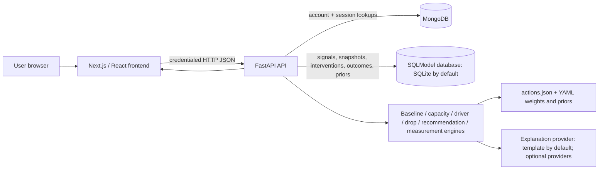

# System Architecture

## Component diagram

## Responsibilities

- **Web:** Next.js App Router routes and React components; forms, visualizations, session state, API calls.
- **API:** FastAPI routers perform validation, resolve identity, coordinate business logic, and serialize responses.
- **Authentication store:** MongoDB `users` and `sessions` collections. Mongo is contacted lazily by auth operations; health and non-auth requests can be available independently of it.
- **Product store:** SQLModel tables using `DATABASE_URL`, SQLite by default. Activity is stored server-side in the API process environment, not solely in the browser.
- **Engine:** Python modules compute baseline/capacity, drivers, drops, recommendations, and outcome summaries.
- **Text layer:** default deterministic template; optional Gemini/Ollama/OpenAI-compatible providers, with schema/phrase consistency validation and template fallback.

## Request/data flow

The browser sends JSON and includes credentials. Authentication endpoints set or clear the HTTP-only session cookie. Protected requests hash the presented session token and validate the MongoDB session/user. The API maps the authenticated account ID to a product profile and scopes product queries by that ID. For a check-in it validates numeric ranges, intercepts configured crisis phrases, persists signals, computes a snapshot, and may persist an intervention. Later requests update intervention status and create an outcome. Insights query those records.

## Storage boundary

MongoDB is only the account/session store in the current code. SQLite (or another SQLModel-supported configured database) contains application profile/preferences and product data. The default SQLite URL is relative to the API working directory. Local `.env` path loading is also relative to process working directory; start Uvicorn from `apps/api` as documented.

## Local development and deployment

Local defaults are frontend `localhost:3000`, API `localhost:8000`, MongoDB `localhost:27017`, SQLite file `maxxloop.db`. CORS permits the two localhost frontend origins on port 3000. Docker files exist, but the provided Compose file does not provide MongoDB and its web service configuration needs review for container-to-container API addressing and Next rewrite behavior. See [Deployment](DEPLOYMENT.md); do not infer a verified production deployment.
