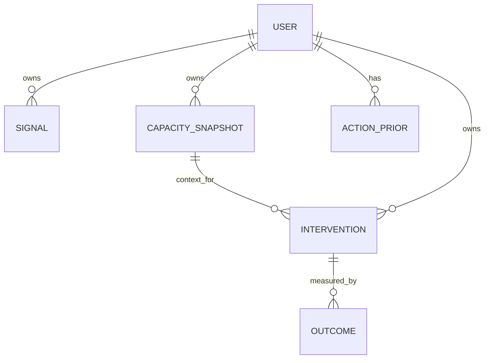

# Data Model

## SQLModel entities

| Entity | Key fields | Purpose / relationship |
| --- | --- | --- |
| `User` | `id`, `display_name`, timezone, created time, consent flags, LLM provider | SQL profile keyed by authenticated Mongo user ID; default model ID exists for demo compatibility. |
| `Signal` | integer ID, `user_id`, timestamp, kind, numeric value, source | Individual observation; user and timestamp/kind are indexed. |
| `CapacitySnapshot` | ID, `user_id`, timestamp, score, baseline, delta, driver JSON, drop flag, context | Calculated state at a moment. |
| `Intervention` | ID, `user_id`, `snapshot_id`, action ID, chosen time, window, status, explanation JSON, provider, exploration flag | One offered action tied to a snapshot. Status values documented in model: offered/started/completed/skipped. |
| `Outcome` | ID, `intervention_id`, pre/post score, observed delta, expected no-action delta, net effect, confidence, helpfulness, note | Follow-up measurement and optional user feedback for an intervention. |
| `ActionPrior` | ID, `user_id`, `action_id`, alpha, beta, updated time | Recommender state for a user/action pair. |

There is no dedicated SQL `Loop`, `CheckIn`, `Action`, or `Insight` table. Check-ins are represented as signals plus snapshots; actions are in `actions.json`; insights are computed from records.

## Entity links

These are logical relationships; some are represented by integer/string fields rather than declared ORM `Relationship` constraints. Mongo `users` and `sessions` are separate from the SQL tables, joined by user ID in application code.

## Data lifecycle

Check-ins add signals and snapshots. Recommendation creates an intervention and may initialize priors. Measurement creates an outcome and updates an existing action prior. Export returns product records. Delete-data removes the user’s signals/snapshots/interventions/outcomes/priors but retains SQL profile and Mongo account.
