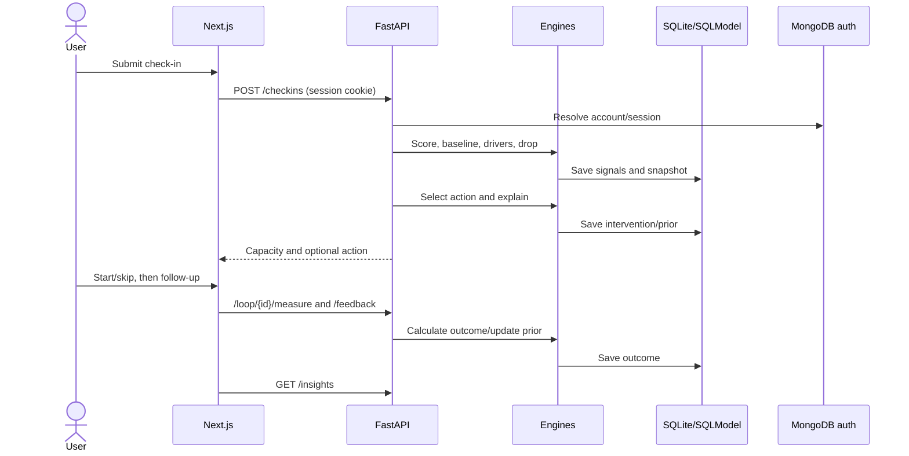

# The MaxxLoop Loop

## Stage 1 — Input and check-in

The user reports Focus, Energy, Stress on 1–5 sliders and may add a note. The web client sends `POST /checkins`. `CheckinCreate` validates values. The safety scanner runs before the normal save path; detected phrases return a crisis card and pause processing.

## Stage 2 — Signal processing and snapshot

For a normal check-in, the API stores three `Signal` rows with source `self_report`, queries the latest values for supported additional kinds, and calls `BaselineEngine` and `CapacityEngine`. `CapacitySnapshot` stores score, baseline, delta, drivers JSON, drop flag, context, user ID, and timestamp. This is a server-side SQL record.

## Stage 3 — Drivers and drop decision

`DriverEngine` turns contributions into labels and selects up to three. `DropDetectionEngine` evaluates configured absolute/rapid thresholds, cooldown and daily limits. The capacity result is an algorithmic estimate, not a clinical measurement. If no eligible drop exists, the user still sees the capacity/status without a new intervention.

## Stage 4 — Recommendation and explanation

When eligible, `RecommenderEngine` filters the action library by driver overlap, initializes user/action Beta priors as needed, samples candidate values, and selects one action (with a default 15% random-candidate exploration branch). The text layer builds a structured explanation using the user’s selected provider or template fallback. An `Intervention` stores action/status/window/explanation/provider and exploration metadata.

## Stage 5 — Action

The client shows the action and timer/steps. Start calls `POST /loop/{id}/start`; skip calls `/skip`. These update status and create data later used for measurement/control-window estimation. The standard window is configured for 25 minutes; demo timewarp can shorten waiting.

## Stage 6 — Measurement

The user reports focus/energy/stress again via `/measure`. The API computes a new score and stores signals/snapshot. `MeasurementEngine` calculates `observed_delta = post - pre`, estimates no-action drift using subsequent snapshots after skipped interventions (blending a default prior when history is sparse), and calculates `net_effect = observed_delta - expected_delta_no_action`. It stores an `Outcome` and confidence category. This is observational self-report, not causal proof.

## Stage 7 — Feedback and update

`POST /feedback` can attach helpfulness to the outcome. Measurement updates the matching action prior: alpha increments when net effect >2; beta otherwise. Helpful boolean is recorded separately; it is not the criterion for this prior update in current code.

## Stage 8 — Insights and next loop

`GET /insights` aggregates saved outcomes, action use, helpfulness, driver categories, time distribution, and trends. Later check-ins can use accumulated history and priors. Sparse history uses population priors/fallback values. The data model stores linked records, not a standalone Loop row.

