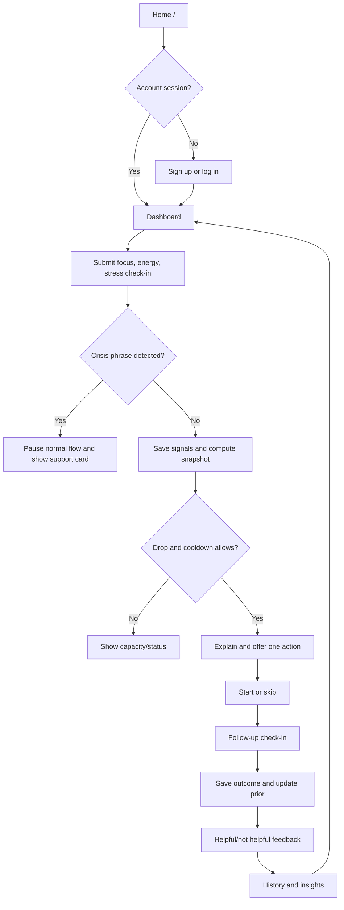

# User Flow

## Standard authenticated journey

## Account flow

Signup collects name, email, and password (minimum 8 characters, maximum 128); email is normalized to lowercase. Successful signup creates an account in MongoDB and returns a session cookie. Login uses the same email/password; logout invalidates the session and clears the cookie. The frontend `AuthProvider` restores current-user state through `/auth/me`. API access to product data requires an authenticated session.

## Check-in and action flow

The dashboard submits Focus/Energy/Stress values to `POST /checkins`. The backend scans optional note text for configured crisis phrases before storing the check-in. If not intercepted, it saves three numeric signals, gets latest additional signals, computes capacity and drivers, checks drop/cooldown, and may create an intervention. The UI displays the response and current loop stage. User action controls call `/loop/{id}/start` or `/skip`; measure and feedback are saved through corresponding endpoints.

## Demo flow

`/demo` is an authenticated demo console. It can seed one of two synthetic personas, trigger a sample capacity drop, time-warp an action window, check demo status, and link to the dashboard in demo context. Seeding resets records for the shared `user_default` demo profile and writes generated history. Treat this data as disposable/demo-only; do not use the demo feature with production data.

## Routes and states

See [Frontend](FRONTEND.md) for every route and expected auth requirement. General API failures are surfaced by the API wrapper as thrown errors; individual page components display their own loading/error/empty states. Exact visual state wording can change with UI code.

## Authentication states

- **Restoring:** client checks `/auth/me` while auth provider initializes.
- **Signed out:** public auth pages remain available; protected data endpoints return 401.
- **Signed in:** provider exposes current user; profile-backed endpoints create/synchronize a SQLite profile row when needed.
- **Session unavailable/expired:** the API rejects the request; user must sign in again.

## Empty and error behavior

New users can have no saved snapshots, actions, or history. API models provide a default capacity response when no snapshot exists and insights are computed from available records. Database/Mongo unavailability may cause API errors. Pages may show empty/error states rather than fabricated user activity. Demo seed data is synthetic and should be labeled as such.
